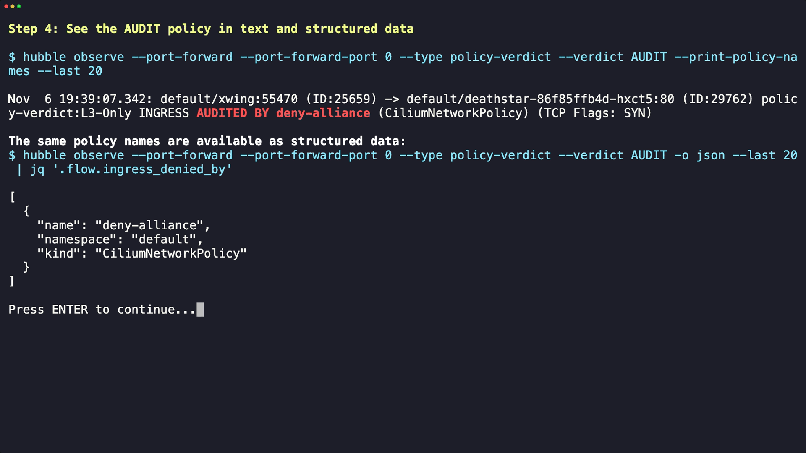
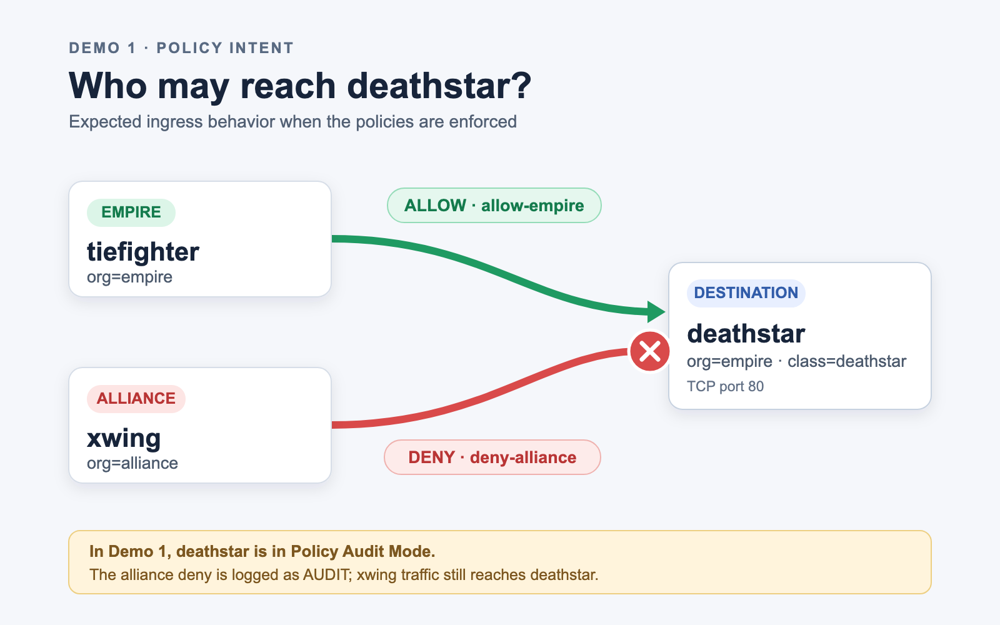
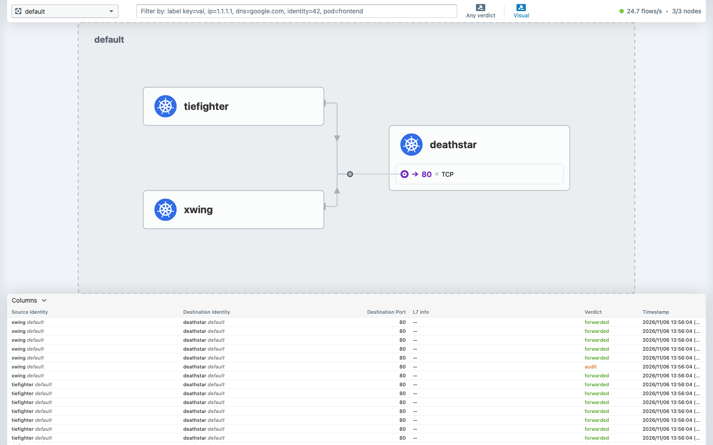
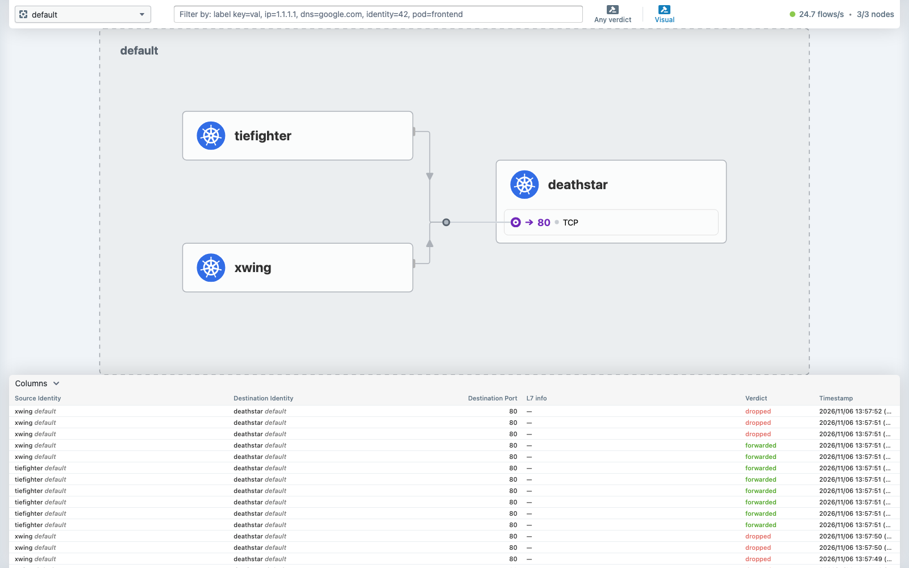

# 01 - Hubble Policy Correlation for Audit Verdicts

See which policy would have denied a flow before you turn enforcement on.

> **Cilium 1.20** | [#45373](https://github.com/cilium/cilium/pull/45373) by [@Rajneesh180](https://github.com/Rajneesh180)

Before 1.20, a flow logged under Policy Audit Mode showed up in Hubble with its
policy fields empty: you saw the flow would have been denied, not which policy
would have denied it. Now audit verdicts (`Verdict_AUDIT`) fill
`ingress_denied_by` / `egress_denied_by`, and `--print-policy-names` prints
`AUDITED BY <policy>`.

## Prerequisites

Completed [00-setup](../00-setup/) and a host Hubble CLI 1.20+ (older CLIs do
not render `AUDITED BY`). The demo opens its own Hubble Relay port-forward.

## How It Works

1. **Policy Audit Mode** on the deathstar endpoints: denies are logged, not enforced
2. **Four policies**: [baseline-allow-ccnp.yaml](baseline-allow-ccnp.yaml) allows empire workloads to receive web traffic (TCP 80/443) from other empire workloads clusterwide, across namespaces. [cnp.yaml](cnp.yaml) defines traffic-specific rules: `allow-empire` (deathstar ingress on TCP 80), `deny-alliance` (deathstar ingress deny), and `xwing-egress` (egress allow). The demo lists the CNPs and CCNP after applying them.
3. **Hubble** names the matching policy on every verdict

| Verdict | Printed as | JSON field |
|---|---|---|
| `FORWARDED` | `ALLOWED BY` | `ingress_allowed_by` / `egress_allowed_by` |
| `DROPPED` | `DENIED BY` | `ingress_denied_by` / `egress_denied_by` |
| `AUDIT` (new in 1.20) | `AUDITED BY` | `ingress_denied_by` / `egress_denied_by` |

## Run the Demo

```bash
cd 01-hubble-audit-policy-correlation
bash demo.sh
```

## Manual Steps

Enable audit mode on a deathstar endpoint (repeat per node it runs on):

```bash
kubectl -n kube-system exec <cilium-pod> -c cilium-agent -- cilium-dbg endpoint config <deathstar-endpoint-id> PolicyAuditMode=Enabled
```

Step 1 of the demo runs this command for each deathstar endpoint across all Cilium agents, then reads the endpoint configuration back to verify `PolicyAuditMode=Enabled`. A single `kubectl exec ds/cilium` can land on an agent that has no deathstar endpoint, so its endpoint listing may show only a header.

Apply the policies and send traffic:

```bash
kubectl apply -f cnp.yaml
kubectl apply -f baseline-allow-ccnp.yaml
kubectl get cnp -n default
kubectl get ccnp baseline-allow
kubectl exec xwing -- curl -s -XPOST deathstar.default.svc.cluster.local/v1/request-landing
```

The curl succeeds (audit mode), but Hubble names the policy that would have blocked it:

```bash
hubble observe --port-forward --port-forward-port 0 --type policy-verdict --verdict AUDIT --print-policy-names
```

Expected output:
```
default/xwing:36272 -> default/deathstar-86f85ffb4d-6ktgx:80 policy-verdict:L3-Only INGRESS AUDITED BY deny-alliance (CiliumNetworkPolicy) (TCP Flags: SYN)
```

As structured data:

```bash
hubble observe --port-forward --port-forward-port 0 --type policy-verdict --verdict AUDIT -o json | jq '.flow.ingress_denied_by'
```

More outputs, including the two policies named on one allowed flow and the
enforced-deny case: [output-examples.md](output-examples.md).

## Scope

Correlation names the policy that *matched* a flow: allows, explicit
`ingressDeny` / `egressDeny`, and now audit verdicts. A default deny (no allow
matched, drop reason 133) has no policy to name and is not correlated.

## Visual Example



For slides you advance manually, use these end-state screenshots from the 28px
[VHS](https://github.com/charmbracelet/vhs) capture:

| Screen | Screenshot for slides |
|---|---|
| Intro | [PNG](demo-01-intro.png) |
| Step 1: Audit mode | [PNG](demo-01-step-1-audit-mode.png) |
| Step 2: Policies | [PNG](demo-01-step-2-policies.png) |
| Step 3: Traffic | [PNG](demo-01-step-3-traffic.png) |
| Step 4: Audit verdict and JSON | [PNG](demo-01-step-4-audit-policy-correlation.png) |
| Step 5: Allowed flows | [PNG](demo-01-step-5-allowed-flows.png) |
| Summary | [PNG](demo-01-summary.png) |

### Policy intent diagram

Use the [slide-ready PNG](demo-01-policy-intent.png) or
[editable SVG](demo-01-policy-intent.svg) to introduce the workload labels and
the intended ingress paths. `baseline-allow` permits empire-to-empire web traffic
clusterwide; `allow-empire` specifically permits `org=empire` traffic from
tiefighter to deathstar on TCP 80. `deny-alliance` matches `org=alliance`
traffic from xwing. The note at the bottom distinguishes this enforced-policy
picture from Demo 1's audit-mode behavior.



### Hubble UI service map

The [audit-mode Hubble screenshot](hubble-ui-audit-traffic.png) shows both
`tiefighter` and `xwing` sending traffic to `deathstar:80`. In this demo,
`PolicyAuditMode=Enabled` makes the `deny-alliance` ingress decision appear as
an orange **audit** verdict; the xwing request still returns HTTP 200.



For a slide about the policy's intended enforced behavior, use the
[enforced-policy screenshot](hubble-ui-enforced-policy.png). It was captured
with audit mode briefly disabled: tiefighter returned HTTP 200, while xwing
failed and Hubble recorded red **dropped** verdicts. Audit mode was restored
on both deathstar endpoints afterward. Hubble can also show **forwarded**
xwing rows for its allowed egress leg; the ingress drop prevents the request
from completing.



Step 4 shows the text verdict and structured policy names together. To
recapture the full GIF and extract its step screenshots from the live cluster:

```bash
vhs demo-01-presentation.tape
../export-presentation-stills.sh 1
```

The [full GIF](demo-01-audit-correlation.gif) remains available. The shared
export script selects settled frames from each demo's recording; review its
timestamps if cluster timing changes on a later capture.

**Use cases**: rolling out deny policies safely, validating policy changes in audit mode, explaining drops during incidents.

## References

- [Creating policies from verdicts](https://docs.cilium.io/en/v1.20/security/policy-creation/#creating-policies-from-verdicts)
- [Policy Audit Mode](https://docs.cilium.io/en/v1.20/security/policy-creation/#enable-policy-audit-mode-specific-endpoint)

Next: [02-ztunnel-metrics](../02-ztunnel-metrics/)
