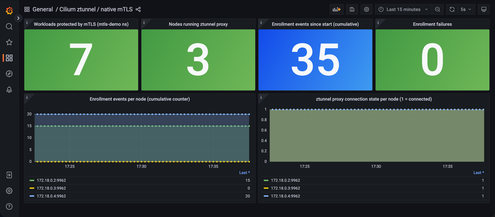

# 02 - ztunnel mTLS Metrics

Observe sidecarless mTLS: enrollment and ztunnel connection health as Prometheus metrics.

> **Cilium 1.20** | [#45096](https://github.com/cilium/cilium/pull/45096) by [@gokulMSFT](https://github.com/gokulMSFT), with [#43763](https://github.com/cilium/cilium/pull/43763), [#44275](https://github.com/cilium/cilium/pull/44275), [#44136](https://github.com/cilium/cilium/pull/44136), [#45861](https://github.com/cilium/cilium/pull/45861) by [@nddq](https://github.com/nddq)

Cilium's ztunnel integration transparently encrypts TCP traffic between pods
in enrolled namespaces, including pods on the same node. 1.20 adds an internal
CA or SPIRE-issued identities, and Prometheus metrics on the Cilium agent.

## Prerequisites

Completed [00-setup](../00-setup/) (`encryption.type=ztunnel`, `prometheus.enabled=true`).

## How It Works

1. **Enroll** a namespace with the label `io.cilium/mtls-enabled=true` ([mtls-demo.yaml](mtls-demo.yaml))
2. **ztunnel** redirects and encrypts the traffic of every pod in it
3. **Metrics** on each agent (`:9962`):

| Metric | Type | Meaning |
|---|---|---|
| `cilium_ztunnel_zds_connection_active` | gauge | 1 when the node's ztunnel proxy is connected |
| `cilium_ztunnel_zds_enrollment_total` | counter | Cumulative enrollment events on the node |
| `cilium_ztunnel_zds_enrollment_failures_total` | counter | Enrollment failures (appears after the first one) |

`zds_enrollment_total` counts events, so it grows with pod churn. It is not the
number of workloads currently protected.

## Run the Demo

```bash
cd 02-ztunnel-metrics
bash demo.sh
```

## Manual Steps

```bash
kubectl apply -f mtls-demo.yaml
kubectl -n mtls-demo exec deploy/client -- curl -s server:8080
kubectl -n kube-system exec ds/cilium -- cilium-dbg metrics list | grep ztunnel
```

Check enrollment:

```bash
kubectl get namespaces -l io.cilium/mtls-enabled=true
kubectl -n kube-system exec ds/cilium -- cilium-dbg statedb dump | jq '.["mtls-enrolled-namespaces"]'
```

## Grafana Dashboard

Import [ztunnel-mtls-dashboard.json](ztunnel-mtls-dashboard.json) into a Grafana
backed by a Prometheus that scrapes the Cilium agents.



The "Workloads protected by mTLS" panel uses kube-state-metrics
(`count(kube_pod_info{exported_namespace="mtls-demo"})`), not a ztunnel metric,
so it needs kube-state-metrics in the cluster.

## Visual Example

*Generated with [VHS](https://github.com/charmbracelet/vhs) from Charm CLI*

To generate the GIF:
```bash
vhs demo-02-ztunnel-metrics.txt
```

**Use cases**: proving mTLS coverage, alerting on enrollment failures, spotting nodes whose ztunnel proxy is disconnected.

## References

- [ztunnel Transparent Encryption](https://docs.cilium.io/en/v1.20/security/network/encryption-ztunnel/)
- [Native mTLS with Cilium](https://cilium.io/blog/2026/03/23/native-mtls-cilium/)
