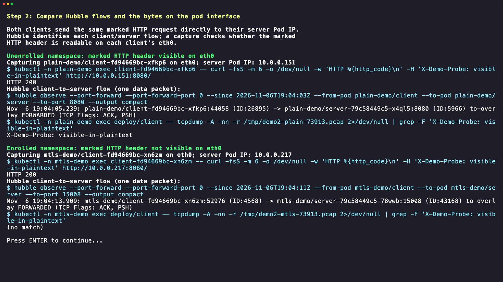

# 02 - ztunnel mTLS Metrics

Observe sidecarless mTLS: enrollment and ztunnel connection health as Prometheus metrics.

> **Cilium 1.20** | [#45096](https://github.com/cilium/cilium/pull/45096) by [@gokulMSFT](https://github.com/gokulMSFT), with [#43763](https://github.com/cilium/cilium/pull/43763), [#44275](https://github.com/cilium/cilium/pull/44275), [#44136](https://github.com/cilium/cilium/pull/44136), [#45861](https://github.com/cilium/cilium/pull/45861) by [@nddq](https://github.com/nddq)

Cilium's ztunnel integration transparently encrypts TCP traffic between pods
in enrolled namespaces. This demo shows the pod-interface traffic and the
Prometheus metrics Cilium 1.20 exports from each agent.

## Prerequisites

Completed [00-setup](../00-setup/) (`encryption.type=ztunnel`, `prometheus.enabled=true`).

## How It Works

1. **Deploy** identical client/server pairs in an unenrolled namespace ([plain-demo.yaml](plain-demo.yaml)) and a namespace labeled `io.cilium/mtls-enabled=true` ([mtls-demo.yaml](mtls-demo.yaml))
2. **Compare** Hubble's client/server flows, then inspect each client's `eth0`: the marked HTTP header is visible in `plain-demo` and absent from the `mtls-demo` capture
3. **Metrics** on each agent (`:9962`) show ztunnel connection health and enrollment events.
4. **Scale** the enrolled server to show enrollment events increasing.
5. **Grafana** opens the provisioned dashboard to inspect connection state and cumulative enrollment events.

The demo uses these metrics:

| Metric | Type | Meaning |
|---|---|---|
| `cilium_ztunnel_zds_connection_active` | gauge | 1 when the node's ztunnel proxy is connected |
| `cilium_ztunnel_zds_enrollment_total` | counter | Cumulative enrollment events on the node |
| `cilium_ztunnel_zds_enrollment_failures_total` | counter | Enrollment failures (appears after the first one) |

`zds_enrollment_total` counts events, so it grows with pod churn. It is not the
number of workloads currently protected.

## Run the Demo

```bash
cd 02-ztunnel-metrics
bash demo.sh
```

## Manual Steps

```bash
kubectl apply -f plain-demo.yaml
kubectl apply -f mtls-demo.yaml
kubectl -n plain-demo rollout status deploy/server deploy/client --timeout=120s
kubectl -n mtls-demo rollout status deploy/server deploy/client --timeout=120s
bash capture-comparison.sh
kubectl -n kube-system exec ds/cilium -- cilium-dbg metrics list | grep ztunnel
```

Both requests should return `HTTP 200`. Hubble shows the plain client/server
flow on port `8080` and the enrolled flow on port `15008`. The helper then
shows the same `tcpdump -A | grep` probe-header search for both captures: the
plain request matches, while the enrolled request has no match. It also prints
a decoded TLS application-data record from the enrolled capture.

Check enrollment:

```bash
kubectl get namespaces -l io.cilium/mtls-enabled=true
kubectl -n kube-system exec ds/cilium -- cilium-dbg statedb dump | jq '.["mtls-enrolled-namespaces"]'
```

## Verify Encryption on the Wire

Step 2 of `demo.sh` sends the same request, including an `X-Demo-Probe` header,
from both client pods to their server Pod IPs. Hubble identifies the source,
destination, and observed port of each flow. It then captures traffic on each
client's `eth0`, the interface carrying the pod's network traffic. The demo
prints and runs `tcpdump -A -r … | grep -F 'X-Demo-Probe: visible-in-plaintext'`
against both captures. The header appears in `plain-demo`; the same grep has
no match in `mtls-demo`. The helper also checks that the enrolled capture has
port 15008 traffic and Hubble reports a data packet for that flow. It stops if
Hubble or the captures do not show the expected result.

Hubble supplies flow metadata here. Without [L7 visibility](https://docs.cilium.io/en/stable/observability/visibility/),
it does not report the HTTP header. Hubble's [`--encrypted` filter](https://docs.cilium.io/en/stable/observability/hubble/hubble-cli/#filtering-encrypted-traffic)
applies to WireGuard/IPsec, so Step 2 uses the captured bytes for the ztunnel
payload comparison. The enrolled Hubble flow may be part of an existing HBONE
connection; its port alone is not proof that this particular HTTP request was
encrypted.

This comparison demonstrates that the HTTP payload is encrypted on the pod
network interface after enrollment. The capture does not expose the TLS peer
certificates, so it does not independently prove mutual authentication. Cilium's
[ztunnel verification guide](https://docs.cilium.io/en/v1.20/security/network/encryption-ztunnel/#validate-the-setup)
uses port `15008` as the HBONE traffic check.

In this kind cluster, requests to the `server` Service IP returned `HTTP 200`
but produced no HBONE packets. The comparison therefore sends requests directly
to ready server Pod IPs.

## Grafana Dashboard

The [00-setup](../00-setup/) script installs Prometheus and Grafana, configures
Prometheus to scrape Cilium agent metrics, and
provisions [ztunnel-mtls-dashboard.json](ztunnel-mtls-dashboard.json) in Grafana.
No manual dashboard import is needed.

Step 5 of `demo.sh` opens the dashboard through a temporary port-forward. The
link stays active while that step waits for ENTER. When the demo ends, it
silently scales the mTLS server back to one replica and waits for the extra
server Pods to disappear.

For manual access outside the demo, start a port-forward:

```bash
kubectl port-forward -n monitoring svc/monitoring-grafana 3000:80
```

Visit <http://localhost:3000>, sign in as `admin`, and retrieve the generated
password with:

```bash
kubectl get secret -n monitoring monitoring-grafana -o jsonpath='{.data.admin-password}' | base64 --decode; echo
```

The dashboard shows ztunnel connection health and enrollment events from the
Cilium agents. Enrollment events are cumulative, not a live count of protected
pods.


## Visual Example



For slides, use these end-state screenshots from the full recording:

| Screen | Screenshot for slides |
|---|---|
| Intro | [PNG](demo-02-intro.png) |
| Step 1: Enrollment | [PNG](demo-02-step-1-enrollment.png) |
| Step 2: Traffic comparison | [PNG](demo-02-step-2-traffic-comparison.png) |
| Step 3: ztunnel metrics | [PNG](demo-02-step-3-ztunnel-metrics.png) |
| Step 4: Scale | [PNG](demo-02-step-4-scale.png) |
| Step 5: Grafana | [PNG](demo-02-step-5-grafana.png) |
| Summary | [PNG](demo-02-summary.png) |

The [Grafana dashboard screenshot](ztunnel-mtls-dashboard.png) uses a 16:10
presentation view with taller panels.

To regenerate the [full GIF](demo-02-ztunnel-metrics.gif) and its screenshots
with [VHS](https://github.com/charmbracelet/vhs):
```bash
vhs demo-02-ztunnel-metrics.tape
../export-presentation-stills.sh 2
```

**Use cases**: proving mTLS coverage, alerting on enrollment failures, spotting nodes whose ztunnel proxy is disconnected.

## References

- [ztunnel Transparent Encryption](https://docs.cilium.io/en/v1.20/security/network/encryption-ztunnel/)
- [Native mTLS with Cilium](https://cilium.io/blog/2026/03/23/native-mtls-cilium/)

Next: [03-more-observability](../03-more-observability/)
