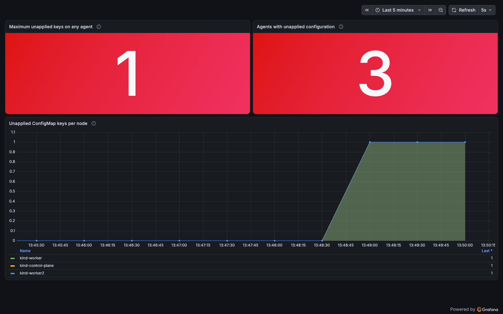
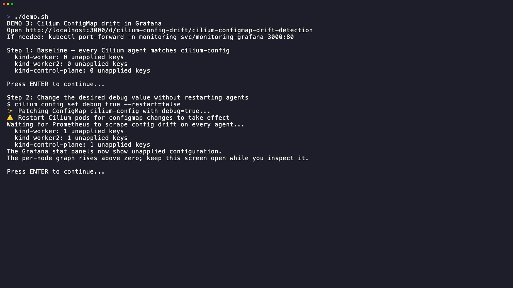

# 03 - More Observability in 1.20

Demo ConfigMap drift detection in Grafana, plus quick references for the other
observability changes.

| Feature | Since | PRs |
|---|---|---|
| [Agent start-up metrics](#agent-start-up-metrics) | 1.20.0 | [#44802](https://github.com/cilium/cilium/pull/44802), [#44639](https://github.com/cilium/cilium/pull/44639) |
| [Standalone DNS Proxy metrics](#standalone-dns-proxy-metrics) | 1.20.0 | [#45222](https://github.com/cilium/cilium/pull/45222), [#44601](https://github.com/cilium/cilium/pull/44601) |
| [`preferIpv6`](#preferipv6) | 1.20.0 | [#45447](https://github.com/cilium/cilium/pull/45447) |
| [ConfigMap drift detection](#configmap-drift-detection) | 1.18.0, Helm values in 1.20.0, 1.19.3, 1.18.9 | [#36510](https://github.com/cilium/cilium/pull/36510), [#44703](https://github.com/cilium/cilium/pull/44703) |

The agent metrics below need `prometheus.enabled=true` (set in [00-setup](../00-setup/values.yaml)).
Read them on any agent with:

```bash
kubectl -n kube-system exec ds/cilium -c cilium-agent -- cilium-dbg metrics list | grep <name>
```

## Run Demo 3

Complete [00-setup](../00-setup/) first. The setup provisions the **Cilium
ConfigMap drift detection** dashboard in Grafana. Open it at
<http://localhost:3000/d/cilium-config-drift/cilium-configmap-drift-detection>
after starting a Grafana port-forward if needed:

```bash
kubectl port-forward -n monitoring svc/monitoring-grafana 3000:80
```

In another terminal, with the Cilium CLI installed, run:

```bash
cd 03-more-observability
bash demo.sh
```

The script shows a zero baseline, changes `debug` in `cilium-config` without
restarting agents, and waits for Prometheus to record a nonzero
`cilium_drift_checker_config_delta`. Pause on Step 2 to see the Grafana stat
panels turn red and the per-node graph rise. Press Enter to restore the original
ConfigMap value; the current value returns to zero and the graph retains the
spike. The script restores the original value if interrupted.



## Visual Example



For slides, use these end-state screenshots from the full recording:

| Screen | Screenshot for slides |
|---|---|
| Step 1: Baseline | [PNG](demo-03-step-1-baseline.png) |
| Step 2: Config drift | [PNG](demo-03-step-2-config-drift.png) |
| Step 3: Restored | [PNG](demo-03-step-3-restored.png) |

The [Grafana drift screenshot](config-drift-dashboard.png) uses a 16:10
presentation view with taller panels while Step 2 is active.

Regenerate the [full GIF](demo-03-config-drift.gif) and its screenshots with
[VHS](https://github.com/charmbracelet/vhs):

```bash
vhs demo-03-config-drift.tape
../export-presentation-stills.sh 3
```

## Agent start-up metrics

> **Cilium 1.20** | [#44802](https://github.com/cilium/cilium/pull/44802), [#44639](https://github.com/cilium/cilium/pull/44639) by [@ILL1A](https://github.com/ILL1A)

Find out where agent start-up time goes. At scale, a slow Kubernetes resource
sync (often `CiliumNode`) is a common reason for the agent hitting its start
timeout, and until now even the logs could not say how long each resource took.

| Metric | Labels | Meaning |
|---|---|---|
| `cilium_hive_populate_duration` | | Time to construct the agent's components (hive Populate) |
| `cilium_hive_start_duration` | | Time to start them (hive Start) |
| `cilium_kubernetes_resource_sync_duration` | `scope` (resource) | Time for one Kubernetes resource to sync |

All three are gauges with one value per agent start. A `cilium_hive_stop_duration`
metric exists too, but the agent never reports it because the agent has stopped by then.

```bash
kubectl -n kube-system exec ds/cilium -c cilium-agent -- cilium-dbg metrics list \
  | grep -E 'hive_(populate|start)_duration|kubernetes_resource_sync_duration'
```

**Use cases**: tracking start-up regressions across upgrades, finding the resource that slows a rollout at scale.

## Standalone DNS Proxy metrics

> **Cilium 1.20** | [#44601](https://github.com/cilium/cilium/pull/44601), [#45222](https://github.com/cilium/cilium/pull/45222) by [@vipul-21](https://github.com/vipul-21)

The Standalone DNS Proxy (SDP, alpha) runs FQDN policy DNS handling outside the
agent, so DNS keeps working while the agent restarts. Until 1.20, moving the
proxy out also meant losing its DNS metrics.

Two changes:

1. **DNS metrics come back through the agent** (#44601). SDP reports request
   timings and verdicts to the agent, which emits the same metrics and access
   logs as the in-agent proxy: `cilium_proxy_upstream_reply_seconds` (per
   `scope`: `totalTime`, `upstreamTime`, `policyCheckTime`, ...) and
   `cilium_policy_l7_total{proxy_type="fqdn"}` (`received`, `forwarded`,
   `denied`, `parse_errors`). Hubble flows show them as `standalone-proxy`.
2. **SDP's own health metrics** (#45222), served by SDP on `:9961`:

| Metric | Meaning |
|---|---|
| `standalone_dns_proxy_cilium_agent_connection_errors` | gRPC connection and policy stream failures to the agent |
| `standalone_dns_proxy_fqdn_mapping_sync_errors` | FQDN mapping sync errors |
| `standalone_dns_proxy_retrieve_dns_rules_errors` | Failures to receive DNS rules |
| `standalone_dns_proxy_proxy_bootstrap_errors` | DNS proxy listener start-up failures |

```yaml
standaloneDnsProxy:
  enabled: true   # alpha
```

```bash
kubectl -n kube-system exec ds/cilium -c cilium-agent -- cilium-dbg metrics list \
  | grep -E 'proxy_upstream_reply_seconds|policy_l7_total.*fqdn'
hubble observe --type l7 --protocol dns
```

**Use cases**: keeping DNS latency and FQDN policy dashboards when moving to SDP, alerting when SDP loses its agent connection.

## preferIpv6

> **Cilium 1.20** | [#45447](https://github.com/cilium/cilium/pull/45447) by [@tibrezus](https://github.com/tibrezus)

In a dual-stack cluster, `cilium-health` always chose IPv4. Where IPv4 is not
routable between sites but IPv6 is, health stayed permanently degraded
(`1/2 reachable`). One top-level value now makes both health probes and Hubble
peer communication prefer IPv6:

```yaml
preferIpv6: true   # agent flag: --prefer-ipv6
```

`hubble.preferIpv6` and `--hubble-prefer-ipv6` are deprecated in favor of it.
They still work and combine with the new value (either one enables it).

```bash
kubectl -n kube-system exec ds/cilium -c cilium-agent -- cilium-health status
```

**Use cases**: IPv6-routable multi-site clusters, IPv6 underlays (`underlayProtocol: ipv6`).

## ConfigMap drift detection

> **Cilium 1.18** ([#36510](https://github.com/cilium/cilium/pull/36510)), Helm values and docs in **1.20.0**, backported to 1.19.3 and 1.18.9 ([#44703](https://github.com/cilium/cilium/pull/44703) by [@PhilipSchmid](https://github.com/PhilipSchmid))

Not new in 1.20, but now documented and configurable through Helm. Many settings
only apply after an agent restart. After a `helm upgrade` or `cilium config set`,
the agent watches `cilium-config` and counts the keys whose desired value
differs from what it runs with.

| Metric | Type | Meaning |
|---|---|---|
| `cilium_drift_checker_config_delta` | gauge | ConfigMap keys the agent has not applied yet. `0` means in sync, anything else means restart the agent |

Enabled by default:

```yaml
configDriftDetection:
  enabled: true        # watch cilium-config
  driftChecker: true   # publish cilium_drift_checker_config_delta
  ignoredKeys: []      # e.g. [devices] for keys managed elsewhere
```

Run the interactive demo above, or inspect the metric directly:

```bash
kubectl -n kube-system exec ds/cilium -c cilium-agent -- cilium-dbg metrics list | grep drift_checker
```

When a desired configuration change is meant to persist, restart the Cilium
agents to apply it. Demo 3 instead restores the original desired value, so no
restart is needed.

**Use cases**: alerting on agents running stale configuration after an upgrade or a config change.

## References

- [Cilium metrics reference](https://docs.cilium.io/en/v1.20/observability/metrics/)
- [Standalone DNS Proxy](https://docs.cilium.io/en/v1.20/security/standalone-dns-proxy/)
- [ConfigMap drift detection](https://docs.cilium.io/en/v1.20/configuration/configmap-drift-detection/)
- [Cilium 1.20.0 release notes](https://github.com/cilium/cilium/releases/tag/v1.20.0)
